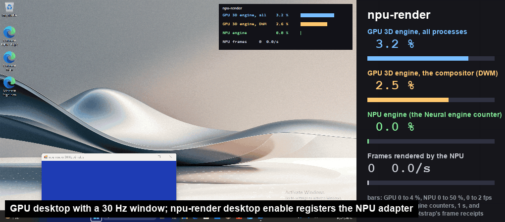
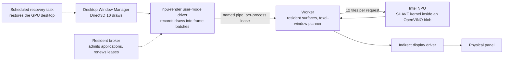

# npu-render

**Your Windows desktop, rendered by the NPU.**

npu-render is a research display driver for Windows 11 that takes the draws
the Desktop Window Manager sends to its graphics card and executes them on an
Intel NPU instead. The compositor keeps speaking Direct3D. A user-mode driver
records its draws into frame batches, a worker runs them in hand-written SHAVE
kernels through OpenVINO, and an indirect display puts the finished frames on
the panel. One command turns it on, one turns it off, and a scheduled recovery
task puts the ordinary display back if anything goes wrong.

> **Status (2026-10-22): a research prototype, not a product.** It renders the
> real desktop (Explorer, the Start menu, Notepad, WPF and Edge windows) for
> tens of minutes at a time, pixel-exact against the host reference on
> everything its kernel runs, and it restores the GPU desktop on demand. It is
> slow: 2 to 3 verified screen updates per second against a 30 Hz target, and
> composition passes that carry a blur take seconds. Every number below was
> measured on one Intel Panther Lake laptop and is labelled as such.

## The switch, recorded



Delta's panel, captured by desktop duplication through one admission
(`npu-render desktop enable`, 660 s, then the recovery that `disable` also
runs), played at three times real time. The side panel is drawn from Windows'
GPU engine counters and the admission bootstrap's frame receipts for the same
second; the small overlay inside the desktop shows the same counters live, and
it is itself composed by whichever adapter composes the desktop at that moment.
When the NPU takes over, the panel shows the NPU's 1024x768 frames scaled to
the display, and the frame counter climbs at about 0.9 frames per second (596
frames in the admission). The GPU 3D engine does not fall: it idled at 0.2 %
before, 0.4 % while the NPU rendered, and 0.2 % after, and the compositor's own
share rose from 0.03 % to 0.24 % because it composes the window that mirrors
the NPU frames onto the physical panel. Delta exposes no NPU utilisation
counter, so NPU activity is counted in frames that reached the panel, never
estimated.

## Why

Every new laptop ships an NPU that sits idle while the GPU composes the
desktop, runs the browser and, increasingly, runs local models. The question
this project asks is narrow and testable: can the NPU take over desktop
composition, end to end, without the applications or the compositor knowing?

The answer so far: it can take it over correctly. It cannot yet take it over
fast, and on this machine the compositor's own load on the GPU's 3D engine is
small enough (p99 under 0.4 % under a 30 Hz window stimulus, with or without
the NPU) that no "freed GPU" is measurable at this workload. Both facts are in
the reports, with the raw evidence.

## How it works



1. **A driver that records instead of executes.** Windows loads npu-render as
   the D3D10 user-mode driver of a registered display adapter. Every draw and
   clear arrives with fully resolved state (shaders, constants, textures,
   blend, viewport), is appended to the current frame batch, and the batch is
   flushed at the ordering boundaries Windows already has: Present, Flush,
   staging maps, CPU writes to sampled resources. The driver keeps a host
   shadow of every private surface with a version counter, so the worker only
   ever receives what changed.
2. **A rasteriser smuggled into an NPU op.** OpenVINO compiles a small
   ScatterElementsUpdate model for the NPU. The compiled blob carries the
   SHAVE code of that op in a text section; npu-render compiles its own
   rasteriser (vertex shading, scanline coverage, bilinear sampling with two
   texel windows, the compositor's blend modes) with the SHAVE toolchain and
   patches it into that window, after growing the window from 24 KB to 48 KB
   by rewriting the ELF and the plugin's metadata trailer. The model's
   input and output tensors become twelve 258 KB spans per inference, one tile
   each, on six SHAVE engines. The NPU driver and firmware run it as any
   other model.
3. **The compositor's shaders, compiled ahead of time.** The 38 shader pairs
   DWM and WinUI actually use (solid and textured quads, Mica and acrylic
   backdrops, the blur, text through an integer byte-buffer fetch and a
   palette, dual-source caption text) are captured once, lowered from SM4
   bytecode to a small IR and emitted as C row functions that run inside the
   kernel. Each is checked bit for bit against an SM4 reference on the host and
   then fixture by fixture on the device; a blob whose fixtures disagree is
   retired at worker start, and its programs take the slower per-draw routes,
   reported, never hidden.
4. **Planning what a tile needs.** The worker cannot ship whole textures to a
   258 KB span, so a shared planner bounds every tile's texel reads with
   interval arithmetic over the pixel program, fits a plane per triangle for
   direct samples, and groups a draw's triangles so a run of glyphs or taskbar
   icons spread across an atlas binds a few small windows instead of the hull
   of all of them. The driver admits a draw with the same code the worker
   packs it with, so the two never disagree.
5. **Admission, leases and recovery.** A per-process lease (controller,
   worker, consumer identities, deadlines, nonces) gates every driver call; a
   resident broker admits ordinary processes automatically and renews leases
   in place; a worker that dies is replaced within a second while the
   compositor keeps its lease; and a scheduled task tears down the devices,
   packages and traces and restores the GPU desktop, on request or on any
   fault.

## What is measured

Gates from the [acceptance plan](docs/research/desktop-offload-plan.md), on
Delta (Intel Panther Lake, Windows 11, NPU driver 5540, OpenVINO 2026.4.1).
Latest results: trial 31 and the application probes v115 to v121 in
[frame-batch-live-trials-2026-10-20.md](docs/research/frame-batch-live-trials-2026-10-20.md).

| Gate | Status |
| --- | --- |
| 1. Routing | Registration, admission, presentation and restoration pass end to end (trials 11 and 12). Driver and worker derive each fallback route from one shared selection; zero disagreements. |
| 2. Continuous rendering | The desktop rendered on the NPU for 2,160 s in trial 12: 744 frame batches, 9,363 commands, zero self-test mismatches, zero worker stderr. Since bundle v23 every captured program, the blur included, runs on the kernel; probe v121 had no fallback inside any batch. |
| 3. Physical presentation | 342 physically submitted frames in trial 12. GPU 3D engine p99 0.37 % over 37 minutes; the GPU-desktop control under a 30 Hz window stimulus shows the same p99, so no engine saving is claimed. |
| 4. Interaction and recovery | Controlled input, cleanup and recovery pass; DWM survives the screen saver and the loss of a worker; the compositor's device churn with application windows was traced to three rejected-draw causes and ended (one device per admission since probe v120). Longest clean admission 40 minutes. Open: after an admission that opened application windows, the topology and the compositor come back but the window-placement recovery restored 7 of 14 placements and not the foreground in probe v121, so the switch's `status` shows that live step as failed; sleep and wake. |
| 5. Responsiveness | **Not met.** 2.5 verified updates/s against a 30 Hz, 300-update stimulus at 1024x768; mouse sent-to-display median 94 ms, p95 1.5 s. The compositor's batches cost tens of milliseconds, seconds when they carry the blur program (tens of microseconds per pixel on one SHAVE). |
| 6. Application coverage | Ordinary processes are admitted automatically and served with zero request failures (Explorer, the Start menu, Notepad, the input host, WinUI apps). WPF and Edge are composited from their own surfaces and never open the adapter. Two rare compositor programs still take the per-draw route, and one captured program is kept out because its device build miscompiles. |
| 7. GPU relief | Not demonstrated. The engine samples show composition left the 3D engine; they do not show another workload gaining from it. |
| 8. Usable switch | `npu-render desktop install --prepare`, `enable`, `status` and `disable` have all run on Delta; the pins follow the latest qualified build. |

Correctness on the kernel path is checked on the device: every blob's fixtures
(234 in bundle v23) are compared pixel for pixel against the host reference,
and a recorded desktop capture replays through the batch path within tolerance
of that reference. Nothing is reported as rendered on the NPU on the strength
of a CPU check or a graph-call latency.

## Try it

You need a Windows 11 machine with an Intel NPU that OpenVINO's NPU plugin
supports, test-signing mode, administrator rights, the pinned OpenVINO SDK and
WDK headers for the native build, and the SHAVE toolchain for the kernel
bundle (it is not redistributed here). Expect the desktop to switch displays,
the compositor to be restarted by the recovery task, and a few minutes without
a usable desktop if something fails; run it on a machine you can reach another
way.

```sh
uv sync --frozen
npm ci && npm run hooks:install
uv run pytest && uv run ruff check . && uv run ruff format --check .
```

On the target machine, with a built tree, a signed package and a qualified
kernel bundle (`tools/delta/make_trial_chain.py` generates the versioned
scripts; the trials report records each step):

```sh
npu-render desktop install --prepare   # package, sign and register the pinned build
npu-render desktop enable              # launch an admission under the resident broker
npu-render desktop status              # what the NPU renders, since when, batches, fallbacks
npu-render desktop disable             # stop the admission and run its recovery
```

## Repository layout

- `native/windows/registered_lab`: the registered D3D10 user-mode driver, the NPU worker, the batch planner and protocol, the host reference kernel and the contract tests.
- `native/windows/ptl_kernels`: the SHAVE kernel sources; `frame_core.h` compiles both into the device kernel and into the host reference.
- `native/`: the C ABI, the OpenVINO providers and the restricted Weston adapter from the earlier compositor work.
- `src/npu_render`: the Python runtime and CLI (the desktop switch, backend selection, diagnostics, carrier tooling).
- `tools/` and `tools/delta/`: build, qualification, replay and trial-chain generation; `tools/delta/trial-chain` holds the currently emitted chain.
- `docs/research` and `docs/validation`: the reports and the raw evidence.

## Working on it

Python tooling runs through uv; install the commit hooks once per checkout
(`npm run hooks:install`). Every commit follows
[Conventional Commits](https://www.conventionalcommits.org/en/v1.0.0/) and CI
checks the whole ancestry; see [CONTRIBUTING.md](CONTRIBUTING.md).

The native tree is CMake. `uv run --group native python tools/build_native.py`
builds the C ABI and its tests under `build/native` against the pinned OpenVINO
wheel. The Windows driver and worker configure from
`native/windows/registered_lab` (MSVC, the pinned OpenVINO SDK and WDK
headers); their contract tests register with ctest, and
`tools/build_registered_lab.py` does a clean build and test without installing
or signing anything. On the target machine `tools/delta/build_native_tree.ps1`
builds the same tree into a numbered build.

The kernel bundle: `tools/frame_blobs.py` emits per-blob headers, fixtures and
a single-file SHAVE source for each blob from the captured inventory. The blobs
are compiled on the target with the pinned SHAVE toolchain that
`tools/build_ptl_kernel.py` expects, patched into the carrier
(`tools/delta/create_frame_carrier.py` compiles it,
`tools/delta/grow_frame_carrier.py` doubles its code window) and qualified
fixture by fixture on the NPU with `tools/delta/qualify_frame_kernel.py`.

Trials are generated, not hand-edited: `tools/delta/make_trial_chain.py`
emits the next numbered chain pinned to a build, a package, a version and a
kernel bundle, and a chain runs package signing, registration qualification,
desktop admission with lease renewal, live presentation and recovery.

## Evidence and history

Reports live in `docs/research`: the acceptance plan, the frame-batch trials,
the switch design, the renderer and kernel notes, and the earlier
first-principles, compositor and coverage studies. Raw evidence for trials
through 2026-10-20 lives in `docs/validation/<date>/<trial>`; the frame-batch
trials' raw evidence (captures, logs, engine samples) stays on the target
machine and the trials report names each transaction. Older measurements are
preserved as written; new results go in new reports.

## Constraints

- Every commit follows Conventional Commits 1.0.0; hooks and CI enforce it with no bypass. See [CONTRIBUTING.md](CONTRIBUTING.md) and [AGENTS.md](AGENTS.md).
- Model weights, compiled device caches and carriers, the SHAVE toolchain, credentials, private machine addresses and virtual environments are never committed.
- CPU checks and graph-call latencies are never presented as proof of NPU execution, display frame delivery or improved performance.
- Device fallback is never hidden and unsupported operations are never claimed as migrated. A failed replacement leaves the active renderer in place.
- Device changes are verified on real hardware where available; unavailable hardware is recorded explicitly.
- Security problems go through [SECURITY.md](SECURITY.md).

## License

Apache License 2.0; see [LICENSE](LICENSE) and [NOTICE](NOTICE) for the
third-party work this project builds on.
