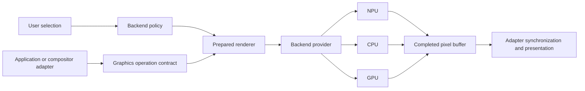

# Architecture

The product goal is a user-level switch that changes where supported graphics
operations run. Integrations retain their normal graphics path and hand supported
operations to a common runtime. Device execution, workload policy, and display
presentation are separate responsibilities.

## Implemented boundary

`Composition` specifies width, height, foreground-layer count, FP16/FP32 interface
precision, and NCHW/NHWC layout. Inputs are premultiplied linear-sRGB RGBA arrays
in back-to-front order. Alpha and color values must follow that contract. There
is no resampling, scene geometry, HDR, or color conversion in the runtime graph.
The demo converts its opaque result to display-encoded RGB only when writing PPM.

`BackendProvider` discovers devices and prepares a `PreparedComposition`. The
first implementation is OpenVINO, supporting explicit CPU/GPU/NPU targets. New
providers can be injected without changing application calls. Device support is
established by preparation and numeric qualification of the actual operation;
enumeration alone is not a capability guarantee.

The provider verifies reported execution devices. CPU fallback, AUTO, HETERO,
and inferred GPU-to-NPU command compatibility are outside the initial contract.
The renderer returns the selected and reported execution devices with every frame.

## Switching and lifetime

The control path prepares and qualifies a candidate with fractional-alpha,
transparent, and opaque-front fixtures. Compilation and warmup may take seconds.
The active backend remains usable during preparation. Activation waits for an
in-flight frame; failed preparation raises an error and preserves the old backend.
Concurrent switch calls serialize. There is no asynchronous unbounded frame queue.

Composition calls serialize per renderer. Inputs must be contiguous, writable,
correctly typed, and stable until the call returns. Outputs are owned arrays that
remain valid across subsequent frames and switches. The provider currently shares
Python inputs and copies outputs; this does not establish zero-copy device memory.

The saved selection applies to new renderers. Existing integrations explicitly
invoke `reload_selection()` on a control thread when notified of a policy change.
There is no system daemon or per-frame configuration polling in this version.

## Extending toward general graphics

Keep a typed operation catalogue rather than intercepting arbitrary opaque GPU
command streams. Future contracts cover bounded filtering, scaling, transforms,
color conversion, and tiled composition. Each needs shape/layout constraints,
independent correctness checks, and explicit capability negotiation. Generic
shader/rasterization support needs a separate frontend and conformance effort.

The first real desktop integration is a Linux compositor renderer (Weston is the
initial candidate). Retain DRM/KMS scanout, display planes, and direct-scanout
opportunities. Client applications may still use the GPU inside their windows.
An NPU compositor alone does not relocate a game's 3D rendering.

Windows application integration can use the same runtime; replacing the global
DWM renderer requires additional architecture work. Current Windows testing proves
device execution, not system-wide composition.

## Resource policy

The objective is useful GPU capacity and improved foreground workload behavior,
not maximum NPU occupancy. Future policy must consider memory traffic, CPU work,
power, deadlines, and NPU contention. Do not infer a gain from device utilization.
The first performance study showed CPU and GPU outperforming NPU on an identical
blend graph; both are required baselines in Tahoma contention experiments.

Use versioned capability/evidence manifests before offering automatic policies.
Explicit user selection remains observable and must never silently become a
different backend. A future fallback policy must be opt-in and report every event.
