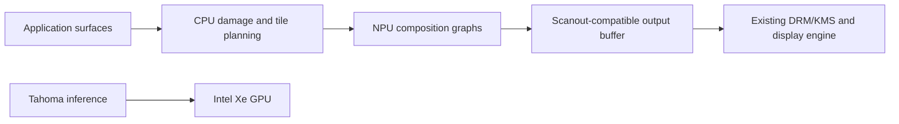

# Deterministic graphics on Intel NPU: a constructive feasibility study

Research, local experiments, and Panther Lake hardware tests: 2026-10-05.
Target: Panther Lake, Windows/Linux; hardware execution tested on Windows.

**Recommendation: pursue a bounded NPU renderer experiment, beginning with desktop
composition.** There is a concrete route from rendering equations to executable
tensor graphs. A missing Vulkan/Direct3D interface does not establish that graphics
cannot run on this hardware. It establishes that we must supply a different
renderer/compiler boundary.

This revises the broader negative recommendation in the
[initial interface assessment](interface-assessment.md). That document's
driver/API observations remain relevant. Its suggestion that neural effects are
the only worthwhile initial pursuit was too restrictive.

The current artifact is an executable graphics probe, not a working NPU desktop.
**Both composition and the restricted triangle graph now execute correctly on
Panther Lake NPU hardware.** We also measured full-frame composition. Presentation,
desktop integration, sustained operation, and Tahoma benefit remain separate gates.

## Separate the questions

| Question | Evidence or next decisive test |
|---|---|
| Can graphics be expressed using the available programming model? | Constructed alpha-composition and restricted rasterization graphs; independently checked their CPU outputs. |
| Will Panther Lake execute these graphs on its NPU? | Yes for the tested cases on delta: explicit NPU compilation/inference, correct outputs, and DPU/SHAVE profiling. |
| Can that implementation meet a useful frame deadline? | Measured promising 1080p one-layer and 720p four-layer host-call latencies. Four layers at 1080p exceed a 60 Hz interval in some samples. Presentation remains unmeasured. |
| Can it replace real desktop work? | Implement a compositor renderer and validate buffers, damage, synchronization, color, and presentation. |
| Does this release a resource that limits Tahoma? | Paired concurrent inference/graphics measurements against the existing compositor. |

An answer at one level must not be promoted into an answer at the next. Equally,
an absent standard GPU API must not be promoted into a hardware impossibility.

## Construct the rendering operations

For premultiplied RGBA in a specified color space, source-over composition is:

```text
output = foreground + (1 - foreground.alpha) * background
```

That is channel selection, subtraction, multiplication, and addition. Repeating
the equation composes a stack of windows. It requires no trained model and no
approximation by a neural network. Floating-point rounding is still relevant.

Other graphics operations also have tensor formulations:

| Operation | Constructive formulation | Remaining difficulty |
|---|---|---|
| Alpha composition | Broadcast multiply/add | Memory bandwidth, intermediate buffers, numeric conventions |
| Color transform | Small matrix multiply / 1×1 convolution | Transfer functions, HDR, exact format conversion |
| Blur | Fixed convolution, often separable | Neighborhood reads, borders, additional traffic |
| Affine image transform | Coordinate calculation, gathers, interpolation | Dynamic indexing, texture locality, filtering quality |
| Triangle coverage | Evaluate three edge equations `a*x+b*y+c`; compare signs | Exact edge rules and sufficient coordinate precision |
| Visibility for opaque geometry | Masked depth reduction and color selection | Depth/stencil conventions, ties, dynamic scene size |
| Perspective interpolation | Interpolate reciprocal depth and attributes, divide | Precision, texture sampling, shader semantics |

The table is a mathematical mapping, not a claim that all rows compile efficiently
on Panther Lake. The included probe implements only composition and restricted
opaque triangle coverage/visibility.

A graph need not be recompiled for every changing desktop frame. Compile fixed
tile sizes and a bounded number of layer slots; supply pixels, transforms, masks,
and geometry as runtime inputs. A CPU scheduler can perform damage tracking,
occlusion, and tile binning. Batch dirty tiles to amortize dispatch overhead.
Unused slots have zero coverage/opacity. Additional shape variants must be compiled
outside the frame loop. This is a proposed implementation, not present in the probe.

Naively evaluating every triangle at every pixel costs `O(pixels * triangles)`.
The three-triangle demonstration does not scale into a game renderer by increasing
the triangle count. Tile binning, bounded local primitive lists, texture access,
and a shader frontend are distinct engineering work.

## Executable evidence

[`research/probe.py`](../../research/probe.py) constructs
OpenVINO graphs directly. It does not import a graphics API or load learned weights.

Composition is checked against independently computed closed-form visibility
weights. The triangle graph uses edge equations and depth reductions; its oracle
uses barycentric linear solves and a z-buffer. Runtime inputs change between
test cases without recompiling the graph.

The rasterizer is deliberately restricted to three opaque, flat-color triangles
with distinct constant depths. Edges are inclusive. It does not implement the
GPU top-left fill rule, textures, antialiasing, perspective, arbitrary shaders,
or graphics API conformance.

Local results, Apple M4 / macOS 26.6.2 / OpenVINO
`2026.1.0-21367-63e31528c62-releases/2026/1`:

| Probe | Result | Largest channel error |
|---|---|---:|
| 96×64 composition, FP32, three cases | Pass | 0.0000001103 |
| 96×64 composition, FP16, three cases | Pass | 0.001070 |
| 96×64 triangles, FP32 and FP16, three cases each | Pass | 0 |
| 1920×1080 composition, FP16, three cases | Pass | 0.001479 |
| 1920×1080 triangles, FP32, three cases | Pass | 0 |
| 1920×1080 triangles, FP16 | **Fail** for visible geometry | 0.84375 |

The full-resolution FP16 triangle failure is informative: coordinate/edge rounding
changes coverage near boundaries. The overlapping cases have 3,037 and 3,039
channels outside tolerance. Simply choosing FP16 for all graphics arithmetic is
not sufficient. Candidate remedies include local tile coordinates, fixed-point
coverage, or higher-precision edge evaluation, each requiring new validation.

The FP16 exploratory tolerance is `2/255`; FP32 uses `1e-5`. These are probe gates,
not a display conformance specification. During development, CPU execution with
FP32 input also initially failed because the backend selected lower internal
precision. The probe now explicitly requests the CPU/GPU inference precision and
records its settings. An input dtype alone does not prove internal precision.

An explicit local NPU request failed because this Mac exposes only CPU to
OpenVINO. The tool returned a failing status and error report rather than falling
back. No CPU number in this document is an Intel NPU performance measurement.
Compact captured correctness evidence is in
[`npu_graphics_local_evidence.json`](npu_graphics_local_evidence.json).

### Panther Lake results on delta

Hardware: **Core Ultra X7 358H, Arc B390, approximately 32 GB RAM**. Software:
Windows 11 Pro build 26200, NPU driver `32.0.100.4724`, GPU driver
`32.0.101.8724`, OpenVINO `2026.1.0-21367-63e31528c62-releases/2026/1`, NumPy
2.4.6, Python 3.12, Balanced power plan. The NPU's observed PCI device ID was
`B03E`. Dependencies were installed in a separate temporary Python environment.

All rows below passed their three correctness cases with the stated exploratory
tolerances. The compositor uses FP16 input/output. Layer counts mean foreground
layers **in addition to one background**. The small rasterizer retained its
restricted semantics. NPU execution reported `NPU` / `Intel(R) AI Boost`; profiling
showed DPU and SHAVE execution, plus DMA for the triangle graph.

| Device / workload | Host buffer mode | Median call | p95 call |
|---|---|---:|---:|
| NPU, 96×64, four-layer composition | Copy | 0.322 ms | 0.327 ms |
| NPU, 96×64, three triangles | Copy | 2.723 ms | 2.944 ms |
| NPU, 1080p, four-layer composition | Copy | 23.060 ms | 24.342 ms |
| NPU, 1080p, four-layer composition | Share requested | 12.867 ms | 15.604 ms |
| GPU, 1080p, same four-layer graph | Share requested | 5.434 ms | 5.806 ms |
| CPU, 1080p, same four-layer graph | Share requested | 3.323 ms | 3.527 ms |
| NPU, 1080p, **one-layer** composition | Share requested | **4.340 ms** | **4.980 ms** |
| NPU, 720p, four-layer composition | Share requested | **5.555 ms** | **5.777 ms** |
| NPU, 1080p, four-layer composition, **NHWC** | Share requested | 42.782 ms | 49.043 ms |

Rows use planar NCHW except the explicit NHWC row. Each full-frame row has 100
warmed synchronous samples; small cases have 20. These were sequential runs,
without controlled thermal history or independent repeated trials. The timed loop
reuses the same input buffers at maximum request rate, without display pacing. The table
describes host calls, **not displayed frame rates**. It excludes frame generation,
pixel-format conversion, synchronization with a compositor, and presentation.
No concurrent Tahoma experiment or power/engine telemetry was performed.

Requesting shared NumPy buffers avoids some Python-side copying; it does not
establish zero-copy device or scanout memory. The large measured improvement makes
buffer management an immediate engineering priority. The slower interleaved NHWC
case also establishes that input layout must be measured on this compiler stack.

The four-layer 1080p shared run had **3/100 calls above 16.67 ms**, with a sample
p99 of 19.455 ms. It does not establish reliable 1080p60. The one-layer 1080p and
four-layer 720p runs had no calls above 16.67 ms in these short samples, with sample
p99 values of 5.052 ms and 5.871 ms respectively. They justify an integration
prototype, not a sustained frame-delivery guarantee.

CPU and GPU were faster than NPU on the same blend graph. A CPU compositor is
therefore an essential control in any Tahoma study. A useful NPU product must
demonstrate a benefit under actual resource contention, not merely execute work
on a different engine. Backend internal arithmetic can differ despite FP16 I/O;
each output was independently checked against the same tolerance.

The complete 12 captured reports, including copy-mode CPU/GPU and NHWC comparisons,
profiling and individual timing samples, are in
[`npu_graphics_delta_evidence.json`](npu_graphics_delta_evidence.json).

### Reproduce and take the probe to Panther Lake

Dependencies are Python, NumPy, and OpenVINO. Use an isolated environment on a
target with an already working, compatible Intel NPU driver. Do not replace a
driver merely to run the initial probe. The local commands used the existing
`.venv-shard/bin/python`; Windows can use its existing environment's `python.exe`.

```sh
python research/probe.py --device CPU --precision f32 --report results/cpu.json
python research/probe.py --device NPU --precision f16 --report results/npu-small.json
python research/probe.py --device NPU --scene composite --precision f16 --width 1920 --height 1080 --iterations 100 --share-host-tensors --report results/npu-1080.json
python research/probe.py --device NPU --scene composite --precision f16 --width 1920 --height 1080 --layers 1 --iterations 100 --share-host-tensors --report results/npu-1080-one-layer.json
```

Run the small case first. The same explicit-device interface accepts GPU for a
comparison. Reports include runtime/device identities, compilation configuration,
unsupported-operation queries, actual execution devices, correctness, host-call
latency samples, and profiling. `--export-dir results/ir` saves the input graph and
hashes. Compilation errors and incorrect output cause a nonzero exit code.

Timing is synchronous host inference. Default mode copies input/output buffers;
`--share-host-tensors` requests Python buffer sharing. `--layout NHWC` tests
interleaved composition input/output. Timing excludes frame preparation and display.
Comparing CPU/GPU/NPU versions
of this graph compares graph backends; it does not compare an optimized native
compositor against the proposed renderer. No telemetry is collected by this tool.

## What the programmable hardware changes

Intel's Panther Lake datasheet describes three neural compute tiles, each with
1.5 MB of CMX memory, a DPU, and two 512-bit ACT-SHAVE processors. It also describes
DMA and hardware synchronization barriers. Thus the physical starting point is
six programmable vector processors alongside the matrix hardware, with local
memory and data movement machinery.
[Series 3 datasheet, section 9.1.2, page 74](https://cdrdv2-public.intel.com/872188/872188-001.pdf#page=74).

Intel's public NPU compiler includes a software-kernel build mechanism using
MoviTools. At inspected revision `0b38f7d42113ff329ac2bdd33583d123de4ccf2f`, its
tree contains 212 `5000xx` software-kernel ELF files. This is stronger evidence
than treating the NPU as only a fixed matrix multiplier. However, the public
tree's build scripts reference a toolchain revision file that is absent from the
inspected tree; a reproducible external custom-kernel toolchain is not established
by the presence of build options.
[Intel software-kernel build documentation](https://github.com/openvinotoolkit/npu_compiler/blob/0b38f7d42113ff329ac2bdd33583d123de4ccf2f/sw_runtime_kernels/README.md),
[prebuilt kernels](https://github.com/openvinotoolkit/npu_compiler/tree/0b38f7d42113ff329ac2bdd33583d123de4ccf2f/sw_runtime_kernels/kernels/prebuild/act_shave_bin),
[toolchain lookup](https://github.com/openvinotoolkit/npu_compiler/blob/0b38f7d42113ff329ac2bdd33583d123de4ccf2f/sw_runtime_kernels/kernels/cmake/mv_tools.cmake).

There is also a concrete external experiment: **npunlock** reports executing
custom C on ACT-SHAVE cores through compiled graph carriers. Its October 4 update
reports connected custom FP32/FP16 conversion kernels agreeing with host oracles.
This establishes useful precedent for working beyond a fixed operator catalogue;
it is the project's reported result, not independently reproduced here.
[Pinned project description](https://github.com/hsfzxjy/npunlock/blob/c23eded3d1d9eec88924f5709b3487640bd796d4/README.md).

Its verified target is **Windows x64, Meteor Lake/NPU3720**, not Panther Lake.
Its custom kernels have constrained layouts/arity and invocation-local memory,
without general global addressing or cross-chunk neighborhood access. It needs
caller-supplied proprietary MoviTools and relies on unstable observed ABIs.
Those limits prevent treating it as a ready-made texture/shader runtime.
[Exact limitations](https://github.com/hsfzxjy/npunlock/blob/c23eded3d1d9eec88924f5709b3487640bd796d4/wiki/LIMITATIONS.md).

Use standard OpenVINO graphs for the first probe. If profiling exposes a specific
fusion or operator bottleneck, investigate a Panther Lake custom-kernel path as a
separate branch. The port must establish ISA/ABI compatibility, accepted executable
format, and a functioning host runtime. Old-generation compatibility is a
hypothesis requiring hardware validation.
[Porting analysis](https://github.com/hsfzxjy/npunlock/blob/c23eded3d1d9eec88924f5709b3487640bd796d4/wiki/PORTING.md).

## Derive the performance budget before designing a driver

For the probe's **four foreground RGBA surfaces plus one background**, reading all
five inputs and writing one output once costs `6 * bytes_per_pixel * pixels`.
With FP16 RGBA, this is `48 * pixels` bytes. It assumes a full update with all
inputs relevant, an ideally fused pass, and no redundant transfers. It is logical
pixel traffic, not a measurement of external DRAM traffic.

| Format and resolution | Logical bytes/frame | At 60 fps |
|---|---:|---:|
| FP16 RGBA, 1920×1080 | 99.53 MB | 5.97 GB/s |
| FP16 RGBA, 3840×2160 | 398.13 MB | 23.89 GB/s |
| RGBA8, 1920×1080 | 49.77 MB | 2.99 GB/s |
| RGBA8, 3840×2160 | 199.07 MB | 11.94 GB/s |

The RGBA8 rows describe a possible packed implementation, not the included graph.
Its format conversion and rounding would need implementation. FP32 traffic is
twice FP16. Intermediate tensors, copies, layout conversion, and display reads
add traffic; damage tracking, occlusion, caches, and overlay/direct-scanout paths
can reduce work.

For four source-over stages, the direct expression requires approximately 36
scalar arithmetic operations/pixel, about 4.48 billion operations/s at 1080p60.
That low arithmetic intensity suggests a bandwidth/dispatch problem. Dividing
this number by advertised INT8 matrix TOPS would be invalid: the implementation
may use vector software kernels and different precisions.

A useful lower-bound model is:

```text
execution_time >= max(logical_bytes / effective_bandwidth,
                      arithmetic_work / applicable_compute_rate)
frame_latency = preparation + queueing + execution + synchronization + presentation
```

For the FP16 full-frame case, hypothetical bandwidth-only times are:

| Effective bandwidth for this operation | 1080p | 4K |
|---|---:|---:|
| 10 GB/s | 9.95 ms | 39.81 ms |
| 20 GB/s | 4.98 ms | 19.91 ms |
| 40 GB/s | 2.49 ms | 9.95 ms |

These are sensitivity calculations, not measured Panther Lake bandwidth. The
frame interval at 60 Hz is 16.67 ms. The required measurement is therefore quite
specific: effective bandwidth, dispatch cost, and extra passes for this graph,
both alone and while Tahoma uses the iGPU.

A 64×64 tile with the five FP16 RGBA inputs and one output contains 192 KiB of
pixel data, below one tile's documented 1.5 MB CMX capacity. Intermediate storage,
alignment and buffering must also fit, but full-frame storage inside the NPU is
unnecessary. Conversely, dispatching separately for all 510 such tiles covering
1080p could waste the latency budget. Compiler tiling and batched dirty tiles are
specific ways to investigate that tradeoff.

Shared memory does not mean cost-free memory. If Tahoma is already limited by
DRAM bandwidth, added NPU traffic can make it slower despite freeing GPU compute.
If its limiting resource is shader/compute scheduling or GPU residency, moving a
meaningful compositor workload may help. We cannot infer the gain from engine
utilization or TOPS alone.

## Where to intercept real graphics

Linux offers a concrete first integration boundary. Weston separates the renderer
that composites surfaces from the backend that handles output, and already has
GPU and CPU renderer implementations. A new renderer can calculate pixels with
the NPU while the existing DRM/KMS backend and display engine present them.
This is an engineering inference from that separation, not an existing NPU
renderer supplied by Weston.
[Weston architecture](https://wayland.pages.freedesktop.org/weston/toc/running-weston.html).



This offloads **compositor rendering**. Applications may still render their own
window contents on the GPU. A game displayed inside a window does not have its
3D rendering offloaded by changing the compositor. A nested Weston instance is
useful for correctness development, but the outer compositor adds work; validate
actual resource relief with the standalone DRM path.

Start with linear buffers and a clearly specified SDR format. OpenVINO documents
NPU memory sharing through DMA-BUF on Linux and NT handles on Windows. That makes
an efficient handoff plausible, but does not guarantee acceptance of every
graphics tiling/compression modifier or scanout allocation. Allocation import,
layout, lifetime, acquire/release synchronization, and output scanout must be
tested together. Keep the initial copied-buffer implementation as a reference.
[NPU remote tensors](https://docs.openvino.ai/2026/openvino-workflow/running-inference/inference-devices-and-modes/npu-device/remote-tensor-api-npu-plugin.html),
[DMA-BUF synchronization](https://docs.kernel.org/driver-api/dma-buf.html).

Windows is suitable for the graph/hardware probe and application-specific
integration. Microsoft places global desktop composition inside DWM. The
examined public documentation does not supply an equivalent replaceable DWM
renderer boundary, so a Windows desktop-wide product requires additional
architecture work. A custom application can still generate its own pixels on
the NPU and present through the existing graphics/display stack.
[DirectComposition architecture](https://learn.microsoft.com/en-us/windows/win32/directcomp/architecture-and-components).

Video processing can adopt the same buffer/effect boundary. Standard media
encode/decode already uses specialized hardware; moving it does not necessarily
recover shader compute. General games require a much larger graphics frontend
and compatibility effort. The original ambition remains a research direction,
with composition providing a bounded first milestone.

## A repository we can progressively ship

Working name: `npu-render`. The first public artifact could be a reproducible
graphics-on-NPU laboratory; an acceleration claim follows measured integration.

```text
graphs/               Deterministic composition, transforms, filters, raster probes
reference/            Independent CPU oracles and image/precision fixtures
runtime/              Explicit device execution, graph cache, buffers, deadlines
integrations/weston/  Renderer using the existing output backend
bench/                Frame delivery and paired Tahoma contention experiments
compat/               Exact hardware, OS, runtime, driver and graph manifests
research/             Optional custom-kernel work, separate from supported runtime
```

Recommended milestones:

1. **Device proof — achieved on delta's Windows configuration:** compile and run
   the small graphs on Panther Lake NPU; check outputs and actual execution device.
   Other stacks still need validation. Record failures as operator/precision
   evidence. Do not conceal unsupported operations with HETERO fallback.
2. **Frame proof:** sustain a selected 1080p60 workload with complete frame costs
   and a provisional p99 processing budget of 8 ms, leaving presentation margin.
   This is a proposed integration gate. The short one-layer 1080p run is encouraging;
   full presentation and sustained operation have not been measured. Test batching,
   damage, and device-buffer sharing where the measured bottleneck justifies them.
3. **Desktop proof:** implement a restricted Linux renderer, first nested for
   correctness and then standalone for resource measurements. Preserve existing
   overlay/direct-scanout opportunities. Specify supported formats, transformations,
   effects, deadline misses, and recovery behavior.
4. **Tahoma proof:** alternate at least five paired runs of the same model,
   prompt/context, desktop trace, frame rate, and power mode. Compare existing
   GPU composition, NPU composition, CPU composition, and the idle-desktop case.
   Report TTFT, tokens/s, tail token/frame latency, memory, and available
   engine/power telemetry. Follow a promising result with a sustained run.
5. **Release proof:** advertise only validated OS/device configurations and
   measured benefits. A provisional 10% Tahoma improvement beyond run variation,
   with acceptable visual quality and deadlines, is a useful product threshold.

If the graph works but is slow, investigate its actual lowering and transfers.
If composition works but frees negligible Tahoma capacity, the renderer can remain
a valid research result without an acceleration claim. If general rasterization
hits precision or texture-access limits, retain the useful composition/filter
subset while investigating those limits independently.

The present conclusion is therefore **yes to a concrete renderer pursuit**.
There is now correct execution on Panther Lake NPU hardware, useful latency for
bounded workloads, and an integration architecture. The remaining unknowns concern
real graphics integration and resource contention, not whether this NPU can
calculate rendered pixels at all.
