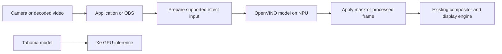

# Panther Lake NPU graphics offload feasibility

Research date: 2026-10-05. Target: Intel Panther Lake, Windows or Linux.
Purpose: move desktop rendering, video, or games onto the NPU so that
Tahoma/Cascadia can use more of the iGPU for inference.

**Updated decision:** pursue a bounded deterministic NPU renderer experiment.
The [first-principles follow-up](first-principles.md) supersedes this
document's original product recommendation. The API gaps below rule out a simple
adapter shim; they do not rule out constructing a renderer from tensor operations
or programmable NPU kernels. The follow-up includes an executable probe and
independent correctness results, including execution on Panther Lake's NPU.
Transparent execution of existing games and
measurable Tahoma acceleration remain unvalidated.

This initial document is a source and repository assessment. The inspected
checkout was `2061db1690e80b0e59952ede620b40f07f5bbfe6`. Its original execution was
on macOS arm64; subsequent Panther Lake hardware measurements are recorded in the
follow-up. Existing repository benchmarks below are reported measurements on
Lunar Lake and are not Panther Lake guarantees.

## What can move

These judgments concern current public interfaces and a maintainable product.
They do not claim that mathematically expressing rendering as tensor operations
is impossible.

| Work | Feasibility | Consequence for the proposed product |
|---|---|---|
| Display scanout and monitor control | No NPU display path | Retain the existing display engine and driver. |
| General Windows desktop or Linux compositor rendering | No existing transparent offload in the examined stack | A new Linux compositor renderer is a concrete research route; Windows needs a separate integration boundary. See the follow-up. |
| Existing Direct3D, Vulkan, or OpenGL games | No practical drop-in offload | NPU graph execution does not implement the graphics pipeline expected by games. |
| Standard video encode/decode | No equivalent NPU codec backend in the examined stack | Use Intel's dedicated media engine; it is separate from shader/matrix execution. |
| Background segmentation, selected denoisers, neural super-resolution | Feasible for compatible models with application integration | Best candidate for an effects plugin; measure the full pipeline and quality. |
| Arbitrary GPU compute shaders | No general substitution via Intel's current Linux NPU API | Would require a compiler/runtime project beyond a driver shim. |
| Restricted 2D blur, blending, or rasterization expressed as tensors | Concrete experiment; target performance unproven | The follow-up constructs composition and triangle graphs and proposes this as the initial renderer milestone. |
| Tahoma model stages or prefill | Already partially implemented in this repo | Useful alternative, but it changes which AI work runs where rather than moving the desktop. |

The graphics and compute interface evidence is detailed below. The effect examples
are workload candidates, not a claim that every model or application supports NPU.

## Current Panther Lake platform and software

Intel launched Core Ultra Series 3 in January 2026, with top configurations offering
up to 12 Xe cores and 50 NPU TOPS. These are distinct accelerators; TOPS does not
measure graphics compatibility or predict end-to-end LLM speed.
[Intel launch announcement](https://www.intel.com/content/www/us/en/newsroom/news/artificial-intelligence/ces-2026-intel-core-ultra-series-3-debut-first-built-on-intel-18a.html).

The OpenVINO NPU plugin identifies Panther Lake as NPU 5010, PCI device `0xB03E`.
Lunar Lake is NPU 4000. A Lunar Lake model blob or performance profile must not be
treated as a Panther Lake artifact.
[NPU plugin platform table](https://github.com/openvinotoolkit/openvino/blob/master/src/plugins/intel_npu/README.md).

Current versions checked:

- OpenVINO **2026.4**, released September 16, 2026. The release notes document
  crashes on Panther Lake Windows systems with certain older NPU drivers and
  recommend **32.0.100.5540 or later**. This matters because Tahoma documents an
  OpenVINO 2026.2+ build requirement.
  [OpenVINO release notes](https://docs.openvino.ai/2026/about-openvino/release-notes-openvino.html).
- Intel Linux NPU driver **v1.38.0**, with Ubuntu 24.04/26.04 packages and an
  explicit validation matrix. Treat its listed kernel/runtime combination as a
  tested configuration, not a universal minimum kernel requirement.
  [Versioned Linux release](https://github.com/intel/linux-npu-driver/releases/tag/v1.38.0).
- Intel Windows NPU driver **32.0.100.5540**, whose supported platforms include
  Panther Lake and Windows 11.
  [Windows driver download and platform list](https://www.intel.com/content/www/us/en/download/794734/intel-npu-driver-windows.html).

Pin the complete OS, driver, firmware, OpenVINO, model, and export configuration for
a shipping support matrix. A newer NPU generation alone does not remove an API gap.

## Why a graphics driver shim is insufficient

### Linux exposes graph execution rather than a GPU kernel interface

Intel's stack is OpenVINO NPU plugin → Level Zero → NPU user-mode driver/compiler
→ `intel_vpu` kernel driver → firmware. The accelerator appears under
`/dev/accel/accel0`. Linux's use of DRM infrastructure for accelerators supplies
shared driver infrastructure; it does not establish Vulkan, OpenGL, or display
support.
[Intel stack overview](https://github.com/intel/linux-npu-driver/blob/v1.38.0/docs/overview.md),
[Linux accelerator subsystem](https://www.kernel.org/doc/html/next/accel/introduction.html).

The strongest evidence is in the released driver source:

- `zeGetModuleProcAddrTable` leaves module creation and kernel-name functions null.
- `zeGetKernelProcAddrTable` leaves kernel creation, argument setting, and group-size
  functions null.
- Image and sampler creation tables are also null.
  [v1.38.0 API implementation](https://github.com/intel/linux-npu-driver/blob/v1.38.0/umd/level_zero_driver/api/ze_misc.cpp).
- The command-list table has `pfnAppendLaunchKernel = nullptr` and null indirect
  kernel launch entries.
  [v1.38.0 command-list implementation](https://github.com/intel/linux-npu-driver/blob/v1.38.0/umd/level_zero_driver/api/ze_cmdlist.cpp).

Inference: sharing the Level Zero loader with Intel GPUs does not make the NPU a
target for existing GPU kernels. Redirecting a GPU command stream or changing a
device name cannot supply the missing execution semantics. A new Mesa/Vulkan
backend would also need a shader compiler, resource model, synchronization,
graphics-state implementation, and an efficient way to execute all of them.

### Windows has the same product boundary

Microsoft's compute-only driver model can participate in Windows scheduling
without becoming a display adapter. Its Direct3D Core feature level excludes
graphics shaders, render targets, swap chains, texture samplers, and 3D/video
queues. This is a description of the compute-only API category, not a claim that
every Intel NPU driver implements every optional compute facility.
[MCDM overview](https://learn.microsoft.com/en-us/windows-hardware/drivers/display/mcdm),
[Direct3D Core feature level](https://learn.microsoft.com/en-us/windows/win32/direct3d12/core-feature-levels).

A virtual display adapter could present an output surface through other hardware.
It would still need something to render the surface. Emulating an adapter does not
turn the NPU into a fast implementation of the rendering operations.

### Software emulation is conceivable but does not validate the business case

Rendering ultimately involves arithmetic. Selected geometry transforms, image
filters, or fixed-size blends could be expressed as tensor graphs. Intel also
publishes its NPU compiler under Apache-2.0, so compiler experimentation is possible.
[NPU compiler repository](https://github.com/openvinotoolkit/npu_compiler).

The engineering problem is the complete workload: dynamic draw calls, texture
addressing/filtering, depth/stencil behavior, blending, shader control flow,
precision, API conformance, presentation deadlines, and changing resources. The
NPU's graph compiler and execution model are a poor starting point for faithfully
covering that surface. This is an engineering inference from the exposed APIs,
not a theorem that no future NPU could render graphics.

An experimental renderer that produces a triangle would establish expressibility.
It would not establish compatibility with a compositor or game, nor demonstrate
that enough iGPU work was removed to help Tahoma.

## Video and desktop activity do not consume one interchangeable GPU resource

Intel's Panther Lake architecture material separates Xe shader/matrix compute,
media encode/decode, and display engines. Its GPU summary specifically identifies
AV1 encode/decode, VVC decode, an MFX media engine, and a display engine with planes
and pixel-processing pipelines. The platform diagrams place media/display and the
NPU separately from the scalable GPU tile.
[Intel architecture deck, pages 18 and 26–29](https://cdrdv2-public.intel.com/866361/ITT_2025_Panther_Lake_Recap1.pdf#page=18).

That distinction changes the expected return:

- **Video playback:** supported hardware decode primarily uses a codec engine.
  Moving that function would not release an equivalent quantity of Xe matrix
  compute. Conversion, scaling, compositing, unsupported codecs, or effects may
  still consume CPU/GPU compute. Establish the actual path before optimizing it.
- **Desktop:** scanout and some plane composition can use display hardware.
  Compositor effects and application rendering can use shader resources. The split
  depends on the OS, compositor, content, and driver; an idle desktop should not
  be assigned a presumed large inference penalty.
- **Games:** substantial shader and memory traffic can overlap resources needed
  by inference. This is the case with potentially large contention, but also the
  least amenable to NPU substitution.
- **Neural video effects:** if the effect currently executes on the iGPU, moving
  that model to the NPU can remove real compute work. If it already executes on
  the CPU or NPU, it offers no direct recovery of GPU compute.

All of these still interact through system memory and platform power/thermal
limits. NPU offloading can reduce GPU execution while increasing shared-memory
traffic or changing GPU clocks. A lower GPU utilization percentage alone is not
proof of a faster Tahoma workload.

## An alternative graphics-adjacent project

An independently feasible candidate is a **Panther Lake NPU effects plugin** with
explicitly supported effects and applications. Start with one segmentation or
denoising model in one host, such as OBS, while Tahoma keeps its main model on GPU.
Neural super-resolution is another candidate; standard video decoding and general
game rendering remain on their existing paths.



The plugin would need to replace or disable the application's original effect.
Applying the same effect twice or processing an unrelated virtual-camera stream
does not offload the original workload. Third-party applications must expose a
plugin, select a virtual camera, or otherwise cooperate. A service cannot
transparently migrate an arbitrary application's internal GPU state.

OpenVINO's NPU remote-tensor API supports sharing allocations with graphics APIs,
using DMA-BUF handles on Linux and NT handles on Windows. This makes an efficient
effect boundary plausible. It does **not** mean the NPU executes Vulkan or DirectX
commands. Buffer layout, format conversion, allocation lifetime, and synchronization
still need implementation and measurement; first validate a host-buffer path,
then optimize transfers.
[NPU remote-tensor API](https://docs.openvino.ai/2026/openvino-workflow/running-inference/inference-devices-and-modes/npu-device/remote-tensor-api-npu-plugin.html).

A practical v0.1 contract would include:

- One named model and fixed input shapes, with documented quality and latency.
- Explicit `NPU`, `GPU`, and `CPU` selection for comparison; report the actual
  execution device and any fallback.
- Bounded queues and a deadline policy. Stale camera frames should not accumulate
  latency; a missed effect deadline should have a defined bypass behavior.
- Precompiled-in-memory/warmed models outside the frame loop, bounded memory,
  device-loss handling, and reproducible version manifests.
- A Tahoma contention benchmark as part of the release evidence.

The generic NPU plugin now has bounded dynamic-shape support as a vision preview;
HETERO support remains partial and model-dependent. Neither feature supplies a
universal graphics translation layer. Fixed shapes are the smaller initial
compatibility target. OpenVINO also cautions against assuming offline blobs are
portable across versions.
[NPU device support and limitations](https://docs.openvino.ai/2026/openvino-workflow/running-inference/inference-devices-and-modes/npu-device.html).

### Existing projects narrow the new repository's value

There is already primary-source precedent for this product category:

- **Linux Studio Effects** uses OpenVINO NPU inference and a virtual camera for
  selected camera effects. Its documented target hardware is Meteor/Arrow Lake;
  that does not establish Panther Lake validation or gains for Tahoma.
  [Project and architecture](https://github.com/ericjchang/linux-studio-effects).
- **Intel OpenVINO plugins for OBS** provide segmentation, framing, and face-effect
  integration examples. Intel archived this repository on August 17, 2026. It is
  useful reference code, not an actively supported dependency assumption.
  [Intel OBS plugins](https://github.com/intel/openvino-plugins-for-obs-studio).
- **ONNX Runtime OpenVINO EP** already exposes NPU selection and graph partitioning,
  with CPU fallback for unsupported NPU models. A new generic ONNX-to-NPU adapter
  would duplicate existing functionality.
  [OpenVINO execution provider](https://onnxruntime.ai/docs/execution-providers/OpenVINO-ExecutionProvider.html).
- The older **Intel NPU Acceleration Library** is archived and directs developers
  toward OpenVINO/GenAI. It is not the recommended foundation.
  [Archived library](https://github.com/intel/intel-npu-acceleration-library).

A new repository should earn its existence through current Panther Lake support,
maintained application integration, good memory handling, and measured concurrent
Tahoma gains. Prefer contributing to an existing suitable project if these are
incremental changes.

## Tahoma already contains the AI placement foundation

The local directory is named `tahoma`; its binary and crates are named Cascadia.
The source confirms more functionality than the older device-profile document
alone suggests:

| Existing implementation | Relevance |
|---|---|
| [`profile.rs`](https://github.com/labscommunity/cascadia/blob/2061db1690e80b0e59952ede620b40f07f5bbfe6/crates/cascadia-cli/src/profile.rs) | Enumerates and benchmarks OpenVINO devices. |
| [`profile_stage.rs`](https://github.com/labscommunity/cascadia/blob/2061db1690e80b0e59952ede620b40f07f5bbfe6/crates/cascadia-cli/src/profile_stage.rs) | Measures static stages on CPU/GPU/NPU and records support/costs. |
| [`placement.rs`](https://github.com/labscommunity/cascadia/blob/2061db1690e80b0e59952ede620b40f07f5bbfe6/crates/cascadia-cli/src/placement.rs) | Implements an offline stage-placement solver with memory constraints. |
| [`run_placement.rs`](https://github.com/labscommunity/cascadia/blob/2061db1690e80b0e59952ede620b40f07f5bbfe6/crates/cascadia-cli/src/run_placement.rs) | Launches workers according to the placement. |
| [`runtime.rs`](https://github.com/labscommunity/cascadia/blob/2061db1690e80b0e59952ede620b40f07f5bbfe6/crates/cascadia-engine-openvino/src/runtime.rs) | Static NPU shards, host KV ring, separate prefill device, AOT import, and optional prefill parking. |
| [`lib.rs`](https://github.com/labscommunity/cascadia/blob/2061db1690e80b0e59952ede620b40f07f5bbfe6/crates/cascadia-cli/src/lib.rs) | Exposes prefill-device, draft-device, NPU context, and placement options. |

This is not a system-wide workload broker. The stage profiler measures individual
forwards; it does not characterize concurrent game/effect contention. Its current
profile fingerprint uses stage names/sizes, device names, and pool budget, so a
new contention study must also record content hashes and hardware/software
versions and force fresh profiling. The optional shared-pool constraint must be
supplied when using the planner to budget unified memory.

Several existing observations prevent overclaiming:

1. On Lunar Lake 258V, the July Llama-3.2-1B static-shard matrix reports long-prompt
   TTFT of **391 ms for chunked GPU**, **644 ms for steady NPU-prefill/CPU-decode**,
   and **1,654 ms for steady chunked CPU**. The NPU helped against the CPU baseline;
   it did not beat the available GPU. NPU decode was competitive or fastest for
   the small 1B/3B configurations, so “NPU is always slower” is also unsupported.
   [Hybrid execution measurements](https://github.com/labscommunity/cascadia/blob/2061db1690e80b0e59952ede620b40f07f5bbfe6/docs/perf/HYBRID_NPU_CPU.md).
2. The placement experiments found a **narrow memory-pressure case** where CPU
   offload helped; they also found that enforcing a nominal GPU memory budget
   could make placement worse. Per-device budgets are not additional physical RAM.
   The document contains older capacity statements contradicted by its later
   measured UMA-spill findings; use the measured operating points and revalidate.
   [Three-tier placement](https://github.com/labscommunity/cascadia/blob/2061db1690e80b0e59952ede620b40f07f5bbfe6/docs/perf/THREE_TIER_PLACEMENT.md).
3. A May Qwen3 export failed on NPU while a HETERO configuration effectively ran
   elsewhere. That is evidence about that export/runtime, not proof that all
   current Qwen3 models fail on Panther Lake. Successful fallback is not proof of
   NPU acceleration.
   [Device profile](https://github.com/labscommunity/cascadia/blob/2061db1690e80b0e59952ede620b40f07f5bbfe6/docs/perf/DEVICE_PROFILE.md).
4. The fleet work encountered large compilation/residency costs and
   graph/driver-sensitive AOT behavior. Its existing `.blob` path checks IR mtime;
   a distributable artifact manifest needs stronger model and compatibility
   identification. GenAI documents its own AOT/caching path, but that does not
   promise portable arbitrary-runtime blobs.
   [NPU tier measurements](https://github.com/labscommunity/cascadia/blob/2061db1690e80b0e59952ede620b40f07f5bbfe6/docs/perf/NPU_TTFT_TIERS.md),
   [GenAI NPU caching and AOT](https://docs.openvino.ai/2026/openvino-workflow-generative/inference-with-genai/inference-with-genai-on-npu.html).

If graphics contention proves severe, adapting Tahoma's own supported AI placement
is a lower-risk alternative to graphics emulation. That is a separate product
choice from the requested desktop-to-NPU offload.

## Performance budget for a useful experiment

An NPU effect must win after input preparation, execution, output handling, and
synchronization. A useful model is:

`effect latency = input preparation + queue wait + NPU execution + output handling + synchronization`

Compare the entire effect path against the GPU implementation at equivalent
quality and output frame rate. At 60 Hz the frame interval is 16.67 ms; at 30 Hz it
is 33.33 ms. Pipelining may preserve throughput while increasing visible latency,
so report both. Game effects have tighter integration requirements than a camera
mask that can sometimes tolerate a stale result.

For scale, a 3840×2160 RGBA8 frame is 33.18 MB. One full input read plus one output
write at 60 fps represents **3.98 GB/s of logical pixel traffic**, before extra
copies, conversions, model activations, or display reads. This is calculated
traffic, not a measurement of external DRAM traffic; cache behavior can change
the latter. A lower-resolution segmentation input is a much easier starting point
than processing every desktop pixel. Shared allocations reduce copying, but they
do not eliminate reads, writes, fences, or layout requirements.

Do not use an NPU utilization target as the objective. Optimize Tahoma throughput
and latency subject to acceptable visual quality, frame delivery, memory, and
power. Maximizing work on the NPU can make the combined system worse.

## Validation plan and decision gates

### First establish that the proposed problem is material

Use a Panther Lake machine with the actual intended memory configuration and
power mode. Repeat the core experiment on both Windows and Linux before claiming
both as supported. Prefer a second Panther Lake GPU/memory configuration before
making a family-wide claim: Series 3 configurations differ.

Measure a fixed Tahoma model, export, prompt corpus, context, and request rate in
these conditions:

| Condition | What it resolves |
|---|---|
| Tahoma alone with normal idle desktop | Reference performance with the display active. |
| Tahoma plus hardware-decoded video, effects off | Cost of actual media/display sharing. |
| Tahoma plus scripted window movement/scrolling/effects | Desktop-compositor contention. |
| Tahoma plus a repeatable game replay | Contention under substantial graphics work. |
| Tahoma plus the selected effect on GPU | Offload candidate baseline. |
| Tahoma plus the identical effect on NPU | Actual benefit and added cost. |
| Tahoma plus effect on CPU, and effect bypassed | Checks whether CPU or bypass is already a better solution. |

Record end-to-end TTFT, decode tokens/s, p50/p95 inter-token latency, video/frame
latency, missed deadlines, effect quality, RAM/commit, CPU load, clocks, and power.
Use per-engine GPU traces where available, rather than a single aggregate GPU
percentage. Confirm actual NPU execution through profiling/telemetry and report
fallback explicitly. Record unsupported telemetry as unavailable.

Separate first compile, cache load, first execution, and warmed steady state.
Alternate test order to limit thermal bias; use at least five paired runs after
warmup, then a 30-minute sustained run for thermal and deadline behavior. Keep
model output/quality checks enabled. Report distributions and uncertainty rather
than only the best run.

### Suggested acceptance criteria

These are proposed product gates, not measured results:

1. The target GPU effect causes a repeatable Tahoma regression of at least 10%
   in throughput or a preselected latency metric. If it does not, this effect is
   a weak candidate for a Tahoma acceleration product.
2. Moving that effect to NPU improves Tahoma by at least 10% against the concurrent
   GPU-effect baseline, with evidence beyond run-to-run variation, acceptable
   output quality, and no material regression in the other selected latency
   metrics. Publish absolute values as well as percentages.
3. For an initial 720p30 camera target, sustain the requested output rate and the
   explicitly chosen end-to-end latency budget, with fewer than 1% missed
   deadlines in the sustained run. Compare against the baseline's miss rate.
4. No driver resets, unbounded memory/queue growth, hidden fallback, or compilation
   in the frame loop. Device loss has a tested bypass/recovery path.
5. Reproduce on each advertised OS and exact driver/runtime combination. A driver
   update that changes compatibility invalidates that configuration's evidence.

If desktop/video alone barely affects Tahoma, stop pursuing desktop offloading.
If only gaming causes serious contention, a camera plugin does not solve that
case. If NPU effects save GPU compute but lose the gain through memory/power
contention, stop the acceleration claim or restrict the supported operating point.

## What a repository could ship

Use a working name such as `panther-npu-effects`, clearly describing an effects
runtime and integration rather than advertising an NPU graphics adapter. A
reasonable repository boundary is:

```text
runtime/            OpenVINO session, capability probes, warmup, bounded queues
integrations/obs/   One explicitly supported video effect
models/             Export recipes, model hashes, shape and quality manifests
bench/              Paired GPU/NPU/CPU effects with concurrent Tahoma runs
compat/             Validated Panther Lake OS/driver/runtime combinations
docs/               Setup, measured results, failures, and supported scope
```

This uses the installed Intel NPU driver. It does not require a new display or
compute kernel driver. Start with one OS for the prototype, then add the second
through the same effect contract; OBS supplies a plausible application boundary
on both. Graphics-buffer interop will still need platform-specific code.

Keep compiled caches local and keyed to the full configuration. Distribute model
recipes/manifests unless weight redistribution is explicitly supported. The
Linux NPU user-mode driver is MIT-licensed and the compiler is Apache-2.0, while
firmware is supplied under separate binary terms. Treat these as separate
packaging inputs; using the system-installed driver avoids owning that entire
distribution stack.
[Driver license](https://github.com/intel/linux-npu-driver/blob/v1.38.0/LICENSE.md),
[Compiler license](https://github.com/openvinotoolkit/npu_compiler/blob/develop/LICENSE),
[Firmware terms](https://github.com/intel/linux-npu-driver/blob/v1.38.0/firmware/bin/COPYRIGHT).

Planning estimates for an engineer familiar with OpenVINO and native multimedia:

- **1–2 engineer-weeks:** baseline contention study and one existing effect on
  Panther Lake, with a written stop/continue decision.
- **Another 2–4 engineer-weeks:** one OS/application prototype, paired benchmarks,
  explicit fallback, and quality checks, assuming the selected model compiles.
- **Another 4–8 engineer-weeks:** second OS, packaging, recovery, interop where
  justified, and a hardware support matrix.

These are estimates, not a delivery commitment. A compiler bug, unsuitable model,
or lack of measurable contention is a stop/re-scope trigger. A full graphics
emulation driver is a separate, substantially larger compiler and compatibility
program with no validated performance case here.

**Revised recommendation:** pursue the deterministic renderer experiment described
in the [first-principles follow-up](first-principles.md). Retain this
effects proposal as an alternative integration path. Neither path should promise
universal GPU replacement or faster Tahoma inference until the corresponding
hardware and contention experiments establish those claims.
